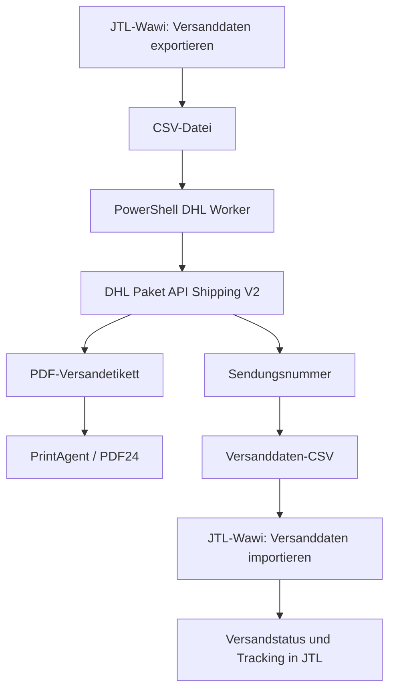

# JTL DHL Worker – Community | Web-NF Fork

**DHL-Versand aus JTL-Wawi mit PowerShell, CSV-Versanddatenimport und automatischem Etikettendruck.**

Dieser Community-Fork wird von [Web-NF (web-nf-nord)](https://github.com/web-nf-nord) gepflegt. Er basiert auf dem [JTL-DHL-Worker von Nikutrax](https://github.com/Nikutrax/JTL-DHL-Worker). Vielen Dank an Nikutrax für die ursprüngliche Entwicklung und die Bereitstellung des Projekts als Open Source.

Das Ziel unserer Weiterentwicklung ist eine praxistaugliche Alternative zu JTL-ShippingLabels für den DHL-Versand, insbesondere für kleinere Händler, ohne direkte Schreibzugriffe auf die JTL-Datenbank.

Dies ist kein offizielles Produkt von JTL oder DHL.

## Download: Web-NF v1.15 (Vorabversion)

**[JTL DHL Community Worker v1.15 – Web-NF Edition herunterladen (ZIP)](https://github.com/web-nf-nord/JTL-DHL-Worker/releases/download/v1.15-web-nf/JTL-DHL-Worker-v1.15-Web-NF.zip)**

[Release-Seite und Version ansehen](https://github.com/web-nf-nord/JTL-DHL-Worker/releases/tag/v1.15-web-nf)

Die erste Web-NF-Version ist als **Pre-release** veröffentlicht. Das ZIP-Paket enthält die weiterentwickelten Skripte und Installationsunterlagen. Die [Text-Quelldateien der Web-NF-Version](web-nf-v1.15/) liegen jetzt auch einzeln im Repository. Der Hauptbranch enthält im Stammverzeichnis weiterhin die ursprüngliche Importbasis; die **v1.15-Weiterentwicklung liegt im Unterordner `web-nf-v1.15`**. Die binäre JTL-Vorlage `.vlg` ist im Release-ZIP enthalten. [Änderungen und Release-Hinweise](web-nf-v1.15/RELEASE_NOTES.md).

**Web-NF-Erweiterungen:** CSV-Versanddatenrückgabe für JTL-Wawi statt direkter SQL-Schreibzugriffe (lesende SQL-Prüfungen bleiben erhalten), zusätzliche Versandarten einschließlich Warenpost International ohne Premium, vereinfachte Production-Zugangseinrichtung mit Zwischenablage sowie anonymisierte Konfigurationsbeispiele.

**Wichtig:** Vor produktivem Einsatz die enthaltene Anleitung lesen und Sandbox- sowie Produktionstests durchführen. Das Paket wurde nicht vollständig in einer fremden JTL-/DHL-Umgebung getestet. Die bisherige PrintAgent-Version bleibt im ursprünglichen Projekt erhalten.

## Entwicklungsstand

**Die Web-NF-Erweiterungen werden derzeit für die Veröffentlichung vorbereitet.** Der aktuelle Quellcode im Fork entspricht zunächst der übernommenen Importbasis v1.14 (PowerShell 5.1), ergänzt um Server- und Print-Agent-Dateien aus v1.13. Die nachfolgend beschriebenen eigenen Erweiterungen sind noch nicht als aktualisierte Skripte in diesem Repository verfügbar.

## Unsere Weiterentwicklung

| Bereich | Ziel bzw. lokal erprobter Entwicklungsstand |
| --- | --- |
| DHL Sandbox | Einrichtung und Validierung von Versandaufträgen ohne produktive Buchung |
| DHL Production | OAuth-Anbindung und produktive Labelerstellung lokal erfolgreich erprobt |
| SQL | Entfernung direkter SQL-Schreibzugriffe auf die JTL-Datenbank |
| CSV-Rückgabe | Erstellung einer Versanddaten-CSV nach erfolgreicher Labelbuchung |
| JTL-Wawi | Rückimport über die integrierte Funktion „Versanddaten importieren“, lokal erfolgreich erprobt |
| Tracking | Übernahme der Sendungsnummer über JTL; Übertragung an eBay lokal erprobt |
| PrintAgent | Separater automatischer PDF-Etikettendruck über PDF24, auch über Netzwerkpfade |
| Versandprodukte | DHL Kleinpaket, Paket und Warenpost International; Erweiterung für Warenpost International ohne Premium in Vorbereitung zur Veröffentlichung |

Die genaue Produktunterstützung, Konfigurationsparameter und Voraussetzungen werden anhand der aktuellen Skripte dokumentiert.

## Geplanter Ablauf ohne direkte SQL-Schreibzugriffe

JTL-Wawi bleibt für die Verarbeitung der Versanddaten verantwortlich. Der Worker übernimmt die Kommunikation mit DHL und die Bereitstellung der Rückgabedaten. Ein direkter SQL-Schreibzugriff ist für diesen geplanten Ablauf nicht erforderlich.

## Geplante Installationsanleitung

Die vollständige Anleitung wird zusammen mit den aktualisierten Skripten veröffentlicht und folgende Bereiche abdecken:

1. DHL-Entwicklerkonto und Sandbox-Zugang einrichten.
2. Konfiguration mit eindeutig beschrifteten Platzhaltern für API-Zugangsdaten, Abrechnungsnummern, Absender und lokale Pfade erstellen.
3. Versanddatenexport in JTL-Wawi einrichten und Versandarten zuordnen.
4. Sandbox-Validierung durchführen.
5. Production-Zugang einrichten und zunächst ausschließlich validieren.
6. Produktive Labelerstellung kontrolliert testen.
7. CSV-Versanddatenimport in JTL-Wawi konfigurieren und prüfen.
8. Optional den PrintAgent für automatischen Etikettendruck und Windows-Autostart einrichten.

Für den Betrieb sind passende DHL-Vertragsprodukte und API-Berechtigungen erforderlich. Die genaue Kompatibilität mit JTL-Versionen und Tarifen wird noch dokumentiert.

## Hinweise zur derzeit verfügbaren Originalbasis

**Achtung:** Die momentan vorhandenen Skripte enthalten noch die ursprüngliche SQL-Integration. Sie entsprechen nicht dem oben beschriebenen CSV-basierten Web-NF-Zielstand.

Die Originalbasis bietet CSV-Übergabe an die DHL Paket API Shipping V2, Labelerstellung, optionalen PDF24-Print-Agent, direkte SQL-Updates von Tracking und Versanddatum sowie Sandbox- und Production-Modus mit expliziten Freigaben. Der parallele JTL-Versanddatenimport ist in dieser Originalbasis nicht vorgesehen.

Für die Originalbasis gilt:

- `config.example.json` nach `config.json` kopieren und lokal konfigurieren.
- CSV-Export entsprechend `JTL-Export-Kopfzeile.txt` einrichten.
- Zuerst Sandbox-Validierung durchführen.
- Production-Zugang unter dem Windows-Konto des Workers einrichten und zunächst nur validieren.
- Echtversand erst nach erfolgreichen Tests und Datenbank-Backup freigeben.
- `EnableExperimentalShippingStatusSql` auf `false` belassen; `AmazonPlatformId` auf `0` belassen, bis die installationsabhängige Zuordnung geprüft wurde.

Die ergänzenden Startskripte und Print-Agent-Dateien aus v1.13 wurden in der übernommenen Importbasis nicht mit v1.14 auf Kompatibilität getestet. Siehe [historische Anleitung v1.13](docs/legacy/README-v1.13.txt).

## Sicherheit und Datenschutz

- Keine echten API-Schlüssel, Passwörter, Tokens, Kundendaten oder produktiven Konfigurationsdateien veröffentlichen.
- Beispielkonfigurationen ausschließlich mit Platzhaltern bereitstellen.
- Sandbox und Production klar trennen.
- Vor dem Produktivbetrieb die Versandarten, Abrechnungsnummern, CSV-Zuordnungen und den Umgang mit wiederholten Buchungsversuchen prüfen.
- Die übernommene Importbasis ist nicht als vollständiges Release getestet und nicht für unkontrollierten Produktivbetrieb freigegeben.

## Mitarbeit und Fehlerberichte

Anregungen, Verbesserungsvorschläge und Erfahrungsberichte sind willkommen.

- [Issues dieses Forks](https://github.com/web-nf-nord/JTL-DHL-Worker/issues)
- [Originalprojekt von Nikutrax](https://github.com/Nikutrax/JTL-DHL-Worker)
- [Anleitung zur Mitarbeit](CONTRIBUTING.md) (aus dem Originalprojekt übernommen)

Bitte bei Fehlerberichten keine vertraulichen Daten oder personenbezogenen Versandinformationen veröffentlichen.

## Lizenz und Urheberhinweise

Der Projektcode steht unter der [GNU General Public License v3.0 (GPL-3.0-only)](LICENSE). Die ursprünglichen Urheber- und Lizenzhinweise bleiben erhalten. Die Rechte an externen Produkten und Marken bleiben unberührt.

**Originalentwicklung:** Nikutrax  
**Weiterentwicklung dieses Forks:** Web-NF / web-nf-nord
